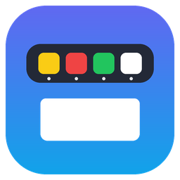

# Mekong Dock

Thanh ứng dụng kiểu macOS cho Windows 10/11, đặt ở **mép trên màn hình**. Viết bằng Python + Tkinter, chỉ dùng thư viện chuẩn. Không cần cài thêm gói, không cần build exe.

## Tính năng

- **Dock kiểu macOS:** rê chuột vào thì icon phóng to và hiện tên. Chấm dưới icon cho biết ứng dụng đang chạy. Bấm vào thì chuyển sang cửa sổ đang mở; ứng dụng có nhiều cửa sổ thì hiện danh sách để chọn.
- **Ứng dụng đang chạy chưa pin** tự hiện sau vạch ngăn. Chuột phải để chọn "Giữ trong Dock".
- **Nhóm (Stack):** gom nhiều ứng dụng vào một ô, ví dụ nhóm *Terminal* gom mọi cửa sổ dòng lệnh.
- **App web:** trang web mở bằng Chrome `--app` (Mail, ChatGPT, Gemini, NotebookLM…). Dock nhận cửa sổ theo AppUserModelID nên không nhầm với Chrome thường.
- **Finder:** gom các cửa sổ File Explorer vào một icon.
- **Tìm kiếm kiểu Spotlight:** phím `Alt+Space`. Tìm ứng dụng trong Start Menu, app Windows, trang Cài đặt, file trên Desktop. Gõ không dấu được, gõ chữ cái đầu cũng được ("gc" ra Google Chrome). Có máy tính bỏ túi (`12*3+4`) và tìm trên Google.
- **Lịch:** ô lịch kèm âm lịch Việt Nam (thuật toán Hồ Ngọc Đức), đồng hồ, bảng lịch tháng.
- **Google Calendar trên hình nền:** gắn trang lịch nhúng (`<iframe>`) hoặc thẻ sự kiện đọc từ địa chỉ iCal lên lớp hình nền, nằm sau icon Desktop.
- **Âm lượng và Kết nối:** chỉnh âm lượng (Core Audio, lăn chuột trên ô), xem Wi-Fi hoặc Ethernet, lối tắt tới cài đặt Windows.
- **Chế độ Dock:** tự ẩn / luôn hiện, chừa chỗ (cửa sổ phóng to nằm dưới Dock) / luôn hiện, nổi trên cửa sổ. Tuỳ chọn ẩn taskbar Windows.
- **Nhiều màn hình:** chạm mép trên màn hình nào thì Dock hiện ở màn hình đó.
- **Không bị che, không che cửa sổ:** tự né ứng dụng toàn màn hình (video, game, F11); cửa sổ trượt lên vùng Dock thì tự được đẩy xuống.

## Cài đặt

1. Cài Python 3.10 trở lên cho Windows (bản từ python.org đã kèm Tkinter).
2. Nếu dùng lịch Google có múi giờ: `pip install tzdata` (Windows không có sẵn dữ liệu múi giờ).
3. Chạy `Mekong Dock.bat`, hoặc `pythonw mac_dock.pyw`.

Lần đầu chạy, Dock tự lấy các shortcut trên Desktop làm danh sách ứng dụng. Danh sách lưu ở `dock_apps.json`, cài đặt ở `dock_settings.json`, đều cùng thư mục và sửa tay được.

## Sử dụng

| Thao tác | Kết quả |
| --- | --- |
| Bấm icon | Mở ứng dụng / chuyển sang cửa sổ / hiện danh sách cửa sổ |
| Chuột phải icon | Danh sách cửa sổ, đóng cửa sổ, đổi tên, đổi chỗ, gỡ khỏi Dock |
| Chuột phải nền Dock | Thêm ứng dụng, chế độ Dock, ẩn taskbar, lịch trên hình nền, chạy cùng Windows, thoát |
| `Alt+Space` | Tìm kiếm |
| Lăn chuột trên ô loa | Tăng / giảm âm lượng |

Khởi động lại Dock đúng cách (trả lại vùng giữ chỗ cho Windows): `powershell -ExecutionPolicy Bypass -File restart_dock.ps1`.

`tidy_desktop.py` là công cụ phụ: gom shortcut vào `Desktop\Ứng dụng`, tài liệu vào `Desktop\Tài liệu`, có `--undo` để trả lại.

## Ghi chú

- Tắt Dock bằng "Thoát Dock" trong menu. Nếu tắt cưỡng bức khi đang ở chế độ "chừa chỗ", Windows giữ lại dải trống ở mép trên cho tới khi Explorer khởi động lại.
- Lịch trên hình nền chỉ để xem, vì lớp icon Desktop nằm phía trên nên không bấm được.
